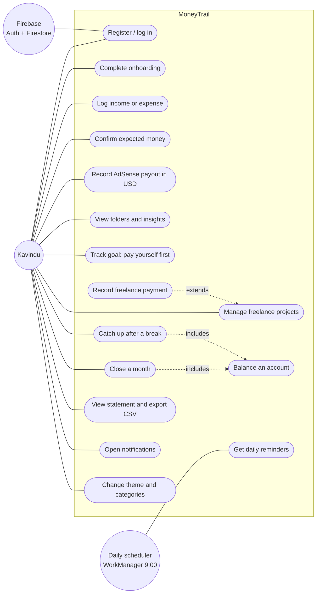
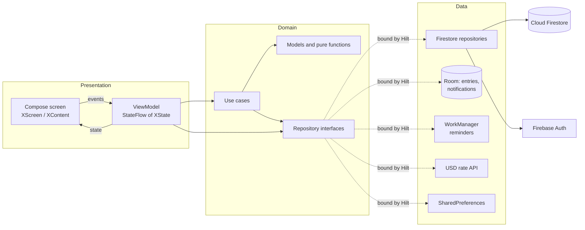
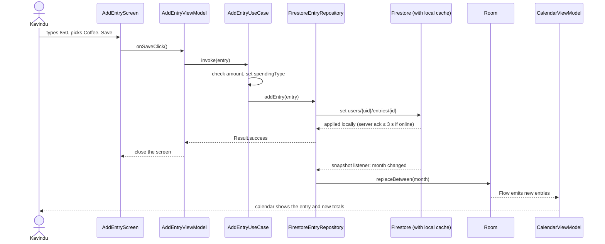
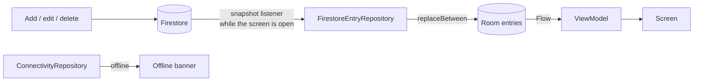
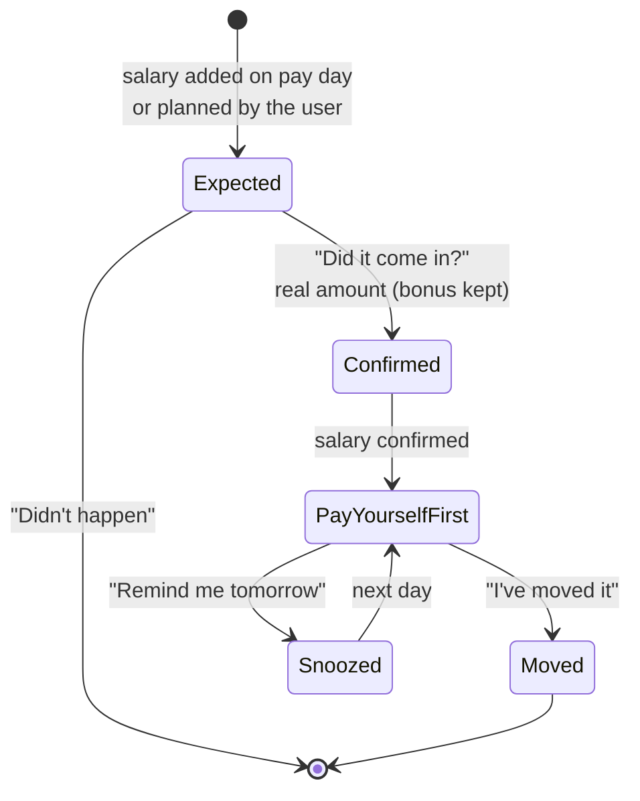
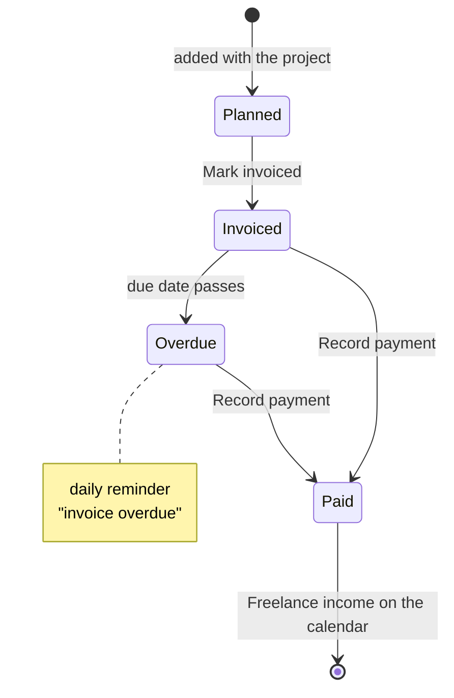
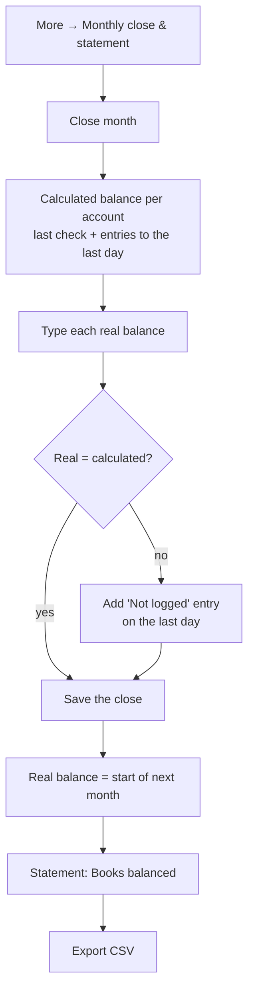
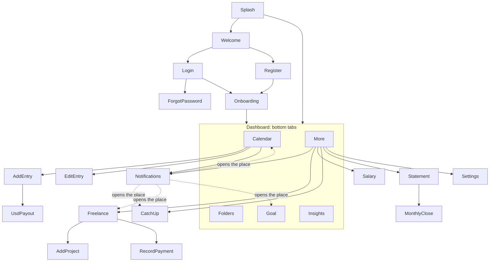

# Diagrams

All diagrams are Mermaid, so GitHub draws them in place.

## 1. Use case diagram



## 2. Architecture (MVVM, layered)



## 3. Write path: logging an expense



## 4. Reading offline



## 5. Expected money and pay day



## 6. Freelance milestone



## 7. Reminders and notifications

```mermaid
sequenceDiagram
    participant WM as WorkManager (9:00)
    participant W as ReminderWorker
    participant G as GetRemindersUseCase
    participant N as ReminderNotifier
    participant L as Room notifications
    actor K as Kavindu
    WM->>W: doWork()
    W->>G: what is due today?
    G-->>W: money due, pay yourself first, catch-up, invoices
    W->>N: show(reminders)
    N->>L: add to history (unread)
    N-->>K: phone notification per kind
    K->>N: taps a notification
    N->>K: app opens on that place
    Note over L: only that kind is marked read;<br/>the rest stay in the list
```

## 8. Monthly close



## Navigation map


